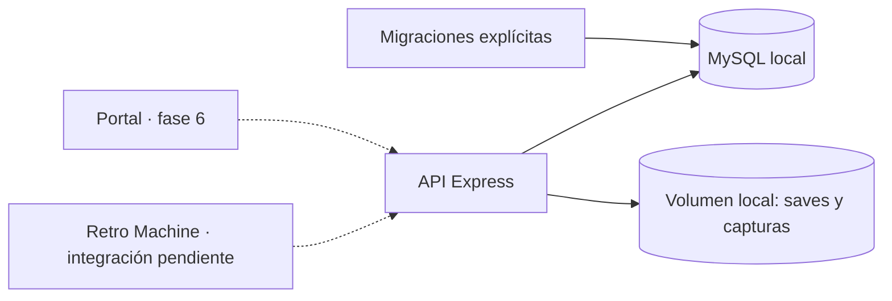

# Arquitectura de Retro Cloud

## Decisiones aprobadas

- Runtime autohospedado: Node.js, MySQL y almacenamiento local en el equipo del usuario.
- Desarrollo y pruebas en Windows; Docker utiliza contenedores Linux.
- Node 24, TypeScript estricto, npm workspaces, Express 5, Zod y Pino.
- Prisma 7 con adaptador MariaDB para MySQL; migraciones SQL versionadas.
- Almacenamiento con las APIs de archivos de Node, sin SDK cloud ni servidor de objetos.
- Metadatos externos y RetroAchievements serán opcionales; no están implementados todavía.
- La instalación inicial descarga paquetes e imágenes. El funcionamiento básico no depende de Internet.

## Integración con Retro Machine pendiente

El código está en otro PC y aún no se ha verificado dónde se ejecuta la emulación.
`agent/` permanece sin lógica. Si la emulación es nativa se estudiarán procesos y carpetas;
si está en el navegador se integrarán eventos y almacenamiento del emulador.
El esquema de nube no contiene rutas locales ni ROMs. Un dispositivo representa una instalación
registrada; no se incrustarán claves de servidor en frontends públicos.

## Componentes y alcance

- `api/`: HTTP, configuración, base de datos y adaptador de disco.
- `packages/shared/`: contratos Zod sin secretos ni Prisma.
- `agent/` y `web/`: workspaces reservados.
- `db/`: esquema y migraciones.
- `scripts/`: generación de entorno e inicialización de almacenamiento.
- `tests/`: validación unitaria y contra infraestructura real.

Solo existen `GET /health/live` y `GET /health/ready`. Readiness consulta MySQL y comprueba
escritura/lectura/borrado de un archivo sintético en cada carpeta. Los probes se eliminan.
Las respuestas de error no muestran detalles internos. Los logs JSON llevan un identificador
de petición y no incluyen cuerpos, cabeceras de autenticación ni URLs de conexión.

## Modelo de datos

| Tablas | Propósito |
| --- | --- |
| users | Email único y hash de contraseña; autenticación pendiente. |
| devices, device_api_keys | Propiedad, revocación y rotación. Solo hashes de claves aleatorias. |
| consoles, games | Juego canónico, consola, título y metadatos. |
| game_files | Hash, algoritmo, tamaño y revisión; nunca binarios ROM ni rutas. |
| library_entries | Presencia por archivo/dispositivo, con baja lógica y unicidad. |
| play_sessions | Identificador del cliente, inicio, fin y duración. |
| save_files | Partida lógica por usuario, juego, tipo, slot y formato. |
| save_versions | Versión, padre, origen, SHA-256, tamaño y storage_key. |
| game_external_ids, metadata_cache | Referencias y caché futura de proveedores opcionales. |
| achievement_accounts | Vinculación opcional; aún sin tokens ni llamadas externas. |
| achievements, user_achievements | Catálogo y desbloqueos softcore/hardcore. |

UUID generables offline y fechas UTC con precisión de milisegundos. Los tamaños BIGINT se
serializarán como cadenas decimales en futuros endpoints. Los hashes son hexadecimales en
minúsculas. Los hashes de RetroAchievements pueden requerir normalización específica;
no se supone que sean el MD5 del archivo completo.

Las claves foráneas compuestas impiden asociar sesiones/versiones a dispositivos de otro usuario,
y exigen que padre e hijo pertenezcan a la misma partida.
Las claves únicas de sesión/operación permitirán identificar reintentos.
CHECK SQL comprueban hashes, versiones positivas e intervalos de sesión.
Revocar un dispositivo conservará su historial; el borrado de cuenta se diseñará después.

## Almacenamiento local

`STORAGE_ROOT` es una ruta absoluta. Compose la fija a `/data/storage` y monta el volumen
`storage-data`. Windows usa su propia ruta de `.env`; son almacenes separados.

El adaptador ofrece initialize, put, read, remove y check. Solo acepta claves de las formas
`saves/<uuid>` y `captures/<uuid>`, rechazando recorridos de directorios, rutas absolutas,
separadores alternativos y nombres especiales de Windows.

Las escrituras usan un archivo temporal exclusivo, sincronizan su contenido y publican
mediante un enlace duro atómico que falla si la clave ya existe. Así una lectura no observa
una escritura parcial y dos escritores no sobrescriben la misma versión.
Se requiere un sistema de archivos con enlaces duros: el volumen Linux de Docker y NTFS
están cubiertos por las pruebas locales. No se ha validado FAT, unidades de red ni carpetas sincronizadas.

Se rechazan enlaces simbólicos/junctions en la raíz, carpetas de categoría y archivos leídos/borrados.
La raíz debe ser de uso exclusivo de la API: no se promete protección frente a un usuario local
con permisos para modificar simultáneamente sus directorios o acceder directamente a los archivos.
En Linux se crean directorios 0700 y archivos 0600; en Windows prevalecen las ACL de la cuenta.
No hay servicio HTTP estático ni endpoint de descarga.

MySQL almacena una clave lógica, no una ruta absoluta. La migración 003 renombra columna e índice,
conservando registros. Las migraciones anteriores permanecen intactas.
Antes del cambio se comprobó que el backend anterior tenía cero archivos y cero versiones;
no hubo archivos reales que trasladar. El volumen antiguo se conserva pero no participa en Compose.

## Versiones y conflictos — fases futuras

Los saves se separan de sus versiones. `format_key` evitará mezclar estados incompatibles.
Un padre permite representar ramas de dos dispositivos sin sobrescribir archivos.
En fase 5 se implementarán asignación de versiones en transacción, subida al cerrar el juego,
resolución explícita de conflictos, restauración como nueva versión y limpieza de archivos huérfanos.
La atomicidad de un archivo no sustituye a una transacción entre disco y MySQL.
Aún no hay endpoints idempotentes, política de selección de rama ni transferencias del agente.

## Ejecución, persistencia y despliegue

El inicializador de almacenamiento y la API comparten volumen y usuario node.
La imagen prepara directorios con el propietario adecuado antes de montar un volumen nuevo.
`migrate` espera a MySQL; la API espera a migrate y storage-init.
Los inicializadores son repetibles. `.env`, archivos y backups no entran en la imagen ni en Git.
Los volúmenes sobreviven a recreaciones y a `docker compose down`.

Se guardarán MySQL y archivos conjuntamente con la API detenida; ver [BACKUPS.md](BACKUPS.md).
El despliegue final será en el equipo del usuario. TLS, autenticación, acceso desde LAN,
automatización de backups y CI opcional quedan para sus fases.
