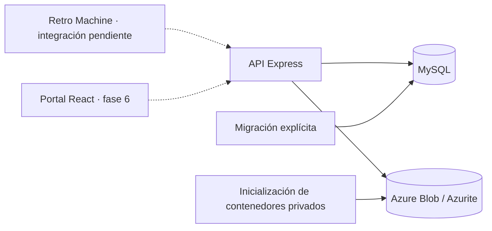

# Arquitectura de Retro Cloud

## Alcance y decisiones

- Fase 1: estructura, API base, MySQL y Azure Blob mediante Azurite en local.
- Desarrollo/pruebas en Windows con contenedores Linux de Docker Desktop.
- Node 24, TypeScript estricto, npm workspaces, Express 5, Zod y logs JSON con Pino.
- Prisma 7 con adaptador MariaDB para MySQL; migraciones SQL versionadas.
- API y herramientas comparten configuración validada, sin secretos en el repositorio.
- El Dockerfile es de desarrollo; conserva herramientas de migración/pruebas.
- No se implementan todavía auth, escaneo, sincronización, portal ni logros.

## Integración pendiente con Retro Machine

El código existente está en otro PC. No se ha verificado dónde se ejecuta la emulación.
`agent/` permanece sin lógica hasta poder inspeccionarlo.

Si es nativa, el adaptador podrá detectar procesos y vigilar carpetas autorizadas.
Si es de navegador, será necesaria integración con eventos y almacenamiento del emulador.
No se presupone que un navegador permita escanear carpetas o detectar procesos libremente.

El identificador de dispositivo describe una instalación registrada; su mecanismo de
registro se definirá en la fase 2. No se incrustarán API keys de servidor en un frontend público.
El modelo de nube no almacena rutas locales ni binarios ROM.

## Componentes

- `api/`: aplicación HTTP, configuración e infraestructura.
- `packages/shared/`: contratos Zod compartidos, sin Prisma ni secretos.
- `agent/`: futuro adaptador y cola offline.
- `web/`: futuro portal React + Vite.
- `db/`: esquema y migraciones SQL.
- `scripts/`: generación de entorno e inicialización de almacenamiento.
- `tests/`: pruebas unitarias y contra infraestructura real.

La API solo expone `GET /health/live` y `GET /health/ready`.
Liveness comprueba el proceso; readiness consulta MySQL y ambos contenedores privados.
Los errores devuelven código, mensaje genérico e identificador de petición.
La configuración incorrecta informa del nombre de la variable, nunca de su valor.

## Modelo de datos

| Tablas | Propósito y restricciones |
| --- | --- |
| users | Email único, hash de contraseña; aún sin endpoints de registro. |
| devices, device_api_keys | Propiedad, revocación y rotación de claves. Solo se almacenará SHA-256 de claves aleatorias; contraseñas requerirán hashing adaptativo en fase 2. |
| consoles, games | Juego canónico, consola, título y metadatos normalizados. |
| game_files | Revisión/archivo identificado por algoritmo, hash y tamaño; sin ROM, ruta ni nombre local. |
| library_entries | Presencia de un archivo en un dispositivo; pareja única y baja lógica. |
| play_sessions | Identificador generado por el cliente, fechas y duración; reenvíos identificables sin duplicar filas. |
| save_files | Partida lógica por usuario, juego, tipo, slot y formato. |
| save_versions | Versiones numeradas, padre, origen, checksum SHA-256, tamaño y clave de blob única. |
| game_external_ids | IDs por proveedor; admite varias referencias por juego. |
| metadata_cache | JSON cacheado por proveedor/clave, con caducidad. |
| achievement_accounts | Vinculación futura de usuario/proveedor; sin tokens. |
| achievements, user_achievements | Catálogo por juego externo y desbloqueos softcore/hardcore. |

Se usan UUID generables offline y fechas UTC con precisión de milisegundos.
Los tamaños son BIGINT sin signo; una futura API deberá serializarlos como cadenas decimales.
Las duraciones son segundos activos no negativos; las sesiones abiertas tienen fin y duración nulos.
Los hashes se almacenan como hexadecimal en minúsculas; el algoritmo forma parte de su identidad.
CRC32/MD5/SHA1 se reservan para compatibilidad de proveedores: no sustituyen al SHA-256 de integridad.
Los hashes específicos de RetroAchievements pueden requerir normalización por consola; no se
asume que equivalgan al MD5 del archivo completo.

## Integridad e idempotencia

- Las claves foráneas compuestas obligan a que usuario y dispositivo de sesiones/versiones coincidan.
- Las versiones pertenecen a la misma persona que la partida lógica.
- Un padre de versión debe pertenecer a la misma partida; no puede ser la propia versión.
- Unicidad de `(device_id, client_session_id)` y `(device_id, client_operation_id)`.
- Unicidad de `(save_file_id, version)`; la asignación concurrente se resolverá en fase 5.
- CHECK SQL adicionales para hashes, tiempos de sesión y versiones positivas.
- Las relaciones de datos de juego y partidas usan RESTRICT para evitar borrados accidentales.
  Revocar un dispositivo conserva su historial. Borrado/exportación de cuenta queda pendiente.

Las restricciones permiten detectar reintentos, pero los endpoints idempotentes y su respuesta
ante payloads distintos con el mismo identificador todavía no están implementados.

## Saves y conflictos — diseño, no funcionalidad implementada

Se separan partida y versiones. `format_key` evitará mezclar estados incompatibles entre emuladores,
cores o revisiones; su contenido concreto depende de la inspección de Retro Machine.

Una versión conserva su padre. Dos dispositivos que partan del mismo padre podrán producir ramas
distintas sin sobrescribir sus blobs. En fase 5 se implementarán subida al cerrar juego,
transacciones, detección explícita de conflictos y restauración como nueva versión.
El número de versión no implica que una rama sea la elegida por el usuario.
No existe aún una política de resolución, selección de cabeza ni limpieza de blobs huérfanos.

Se guarda `blob_key`, nunca una URL pública o SAS persistida.
Azurite contiene dos contenedores privados: saves y captures.
La fase 1 no acepta subidas de archivos. Los futuros endpoints deberán autenticar al propietario
y validar tipo, tamaño y checksum. Capturas tienen contenedor reservado; su tabla/API queda pendiente.

## Configuración y ejecución

`.env.example` contiene marcadores documentados. `env:init` genera secretos aleatorios en `.env`.
La imagen no copia `.env`; Compose proporciona variables en ejecución.
El usuario MySQL de aplicación solo tiene acceso a su base.
Prisma CLI recibe `DATABASE_URL`; generar cliente y compilar no exige base disponible.

Compose espera primero la salud de MySQL/Azurite. `migrate` aplica únicamente migraciones pendientes
y `storage-init` crea/configura los contenedores privados. La API espera la salida correcta de ambos.
Las inicializaciones son repetibles. La API no aplica migraciones durante su arranque.
Volúmenes nombrados conservan los datos al parar/recrear contenedores.
Los puertos publicados solo escuchan en loopback.

Este entorno usa HTTP local y MySQL sin TLS. No se desplegará tal cual en Azure:
faltan TLS de base de datos, autenticación, secretos gestionados y endurecimiento de producción.

## Fuentes técnicas

- [Prisma 7: configuración, generación y adaptadores](https://docs.prisma.io/docs/guides/upgrade-prisma-orm/v7).
- [Azurite: configuración, cuentas y contenedores](https://github.com/Azure/Azurite/blob/main/README.md).
