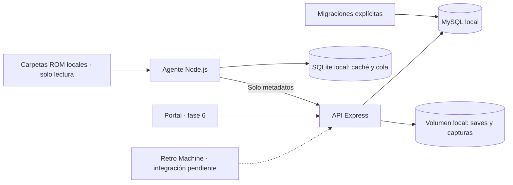

# Arquitectura de Retro Cloud

## Decisiones aprobadas

- Runtime autohospedado: Node.js, MySQL y almacenamiento local en el equipo del usuario.
- Desarrollo y pruebas en Windows; Docker utiliza contenedores Linux.
- Node 24, TypeScript estricto, npm workspaces, Express 5, Zod y Pino.
- Prisma 7 con adaptador MariaDB para MySQL; migraciones SQL versionadas.
- Almacenamiento con las APIs de archivos de Node, sin SDK cloud ni servidor de objetos.
- Metadatos externos y RetroAchievements serán opcionales; no están implementados todavía.
- La instalación inicial descarga paquetes e imágenes. El funcionamiento básico no depende de Internet.

## Integración con Retro Machine pendiente

El código está en otro PC y aún no se ha verificado dónde se ejecuta la emulación.
`agent/` ya permite escaneo de carpetas locales accesibles por Node. La conexión real sigue pendiente.
Si la emulación es nativa se estudiarán procesos y carpetas;
si está en el navegador se integrarán eventos y almacenamiento del emulador.
El esquema de nube no contiene rutas locales ni ROMs. Un dispositivo representa una instalación
registrada; no se incrustarán claves de servidor en frontends públicos.

## Componentes y alcance

- `api/`: HTTP, configuración, base de datos y adaptador de disco.
- `packages/shared/`: contratos Zod sin secretos ni Prisma.
- `agent/`: escáner local, caché, cola SQLite persistente y cliente HTTP por dispositivo.
- `web/`: workspace reservado para el portal.
- `db/`: esquema y migraciones.
- `scripts/`: generación de entorno e inicialización de almacenamiento.
- `tests/`: validación unitaria y contra infraestructura real.

Además de auth, dispositivos y biblioteca, existen `GET /health/live` y `GET /health/ready`.
El contrato HTTP y los ejemplos están en [API.md](API.md). Readiness consulta MySQL y comprueba
escritura/lectura/borrado de un archivo sintético en cada carpeta. Los probes se eliminan.
Las respuestas de error no muestran detalles internos. Los logs JSON llevan un identificador
de petición y no incluyen cuerpos, cabeceras de autenticación ni URLs de conexión.

## Modelo de datos

| Tablas | Propósito |
| --- | --- |
| users | Email normalizado, nombre visible y contraseña scrypt con sal aleatoria. |
| registration_gate | Mutex SQL y cierre permanente del primer registro. |
| auth_sessions, refresh_tokens | Sesión de acceso revocable; refresh de un uso almacenado como hash. |
| devices, device_api_keys | Propiedad, revocación y rotación. Solo hashes de claves aleatorias. |
| consoles, games | Juego canónico, consola, título y metadatos. |
| game_files | Hash, algoritmo, tamaño y revisión; nunca binarios ROM ni rutas. |
| library_entries | Presencia y título privado por archivo/dispositivo, baja lógica y unicidad. |
| play_sessions | Identificador del cliente, inicio, fin y duración. |
| save_files | Partida lógica por usuario, juego, tipo, slot y formato. |
| save_versions | Versión, padre, origen, SHA-256, tamaño y storage_key. |
| game_external_ids, metadata_cache | Referencias y caché futura de proveedores opcionales. |
| achievement_accounts | Vinculación opcional; aún sin tokens ni llamadas externas. |
| achievements, user_achievements | Catálogo y desbloqueos softcore/hardcore. |

UUID generables offline y fechas UTC con precisión de milisegundos. Los tamaños BIGINT se
serializan como cadenas decimales en los endpoints. Los hashes son hexadecimales en
minúsculas. Los hashes de RetroAchievements pueden requerir normalización específica;
no se supone que sean el MD5 del archivo completo.

Las claves foráneas compuestas impiden asociar sesiones/versiones a dispositivos de otro usuario,
y exigen que padre e hijo pertenezcan a la misma partida.
Las claves únicas de sesión/operación permitirán identificar reintentos.
CHECK SQL comprueban hashes, versiones positivas e intervalos de sesión.
Revocar un dispositivo conserva su historial; el borrado de cuenta se diseñará después.

## Almacenamiento local

`STORAGE_ROOT` es una ruta absoluta. Compose la fija a `/data/storage` y monta el volumen
`storage-data`. Windows usa su propia ruta de `.env`; son almacenes separados.

El adaptador ofrece initialize, put, read, remove y check. Solo acepta claves de las formas
`saves/<uuid>` y `captures/<uuid>`, rechazando recorridos de directorios, rutas absolutas,
separadores alternativos y nombres especiales de Windows.

Las escrituras usan un archivo temporal exclusivo, sincronizan su contenido y publican
mediante un enlace duro atómico que falla si la clave ya existe. Así una lectura no observa
una escritura parcial y dos escritores no sobrescriben la misma versión.
Se requiere un sistema de archivos con enlaces duros: el volumen Linux de Docker y NTFS
están cubiertos por las pruebas locales. No se ha validado FAT, unidades de red ni carpetas sincronizadas.

Se rechazan enlaces simbólicos/junctions en la raíz, carpetas de categoría y archivos leídos/borrados.
La raíz debe ser de uso exclusivo de la API: no se promete protección frente a un usuario local
con permisos para modificar simultáneamente sus directorios o acceder directamente a los archivos.
En Linux se crean directorios 0700 y archivos 0600; en Windows prevalecen las ACL de la cuenta.
No hay servicio HTTP estático ni endpoint de descarga.

MySQL almacena una clave lógica, no una ruta absoluta. La migración 003 renombra columna e índice,
conservando registros. Las migraciones anteriores permanecen intactas.
Antes del cambio se comprobó que el backend anterior tenía cero archivos y cero versiones;
no hubo archivos reales que trasladar. El volumen antiguo se conserva pero no participa en Compose.

## Versiones y conflictos — fases futuras

Los saves se separan de sus versiones. `format_key` evitará mezclar estados incompatibles.
Un padre permite representar ramas de dos dispositivos sin sobrescribir archivos.
En fase 5 se implementarán asignación de versiones en transacción, subida al cerrar el juego,
resolución explícita de conflictos, restauración como nueva versión y limpieza de archivos huérfanos.
La atomicidad de un archivo no sustituye a una transacción entre disco y MySQL.
La biblioteca ya admite reintentos idempotentes; para saves aún no hay endpoints, política
de selección de rama ni transferencias del agente.

## Ejecución, persistencia y despliegue

El inicializador de almacenamiento y la API comparten volumen y usuario node.
La imagen prepara directorios con el propietario adecuado antes de montar un volumen nuevo.
`migrate` espera a MySQL; la API espera a migrate y storage-init.
Los inicializadores son repetibles. `.env`, archivos y backups no entran en la imagen ni en Git.
Los volúmenes sobreviven a recreaciones y a `docker compose down`.

Se guardarán MySQL y archivos conjuntamente con la API detenida; ver [BACKUPS.md](BACKUPS.md).
El despliegue final será en el equipo del usuario. TLS, acceso desde LAN,
automatización de backups y CI opcional quedan para sus fases.

## Autenticación local — fase 2

Contraseñas derivadas con scrypt asíncrono (N=32768, r=8, p=3, sal aleatoria de 16 bytes,
resultado de 64 bytes); comparación constante y trabajo equivalente para usuarios inexistentes.
JWT HS256 con secreto aleatorio de 32 bytes en .env, issuer/audience fijos, sub=userId,
sid=authSessionId, iat y exp obligatorios. Duración: 15 minutos. Se comprueba además en MySQL
que la sesión no esté revocada ni vencida: logout invalida inmediatamente el JWT de esa sesión.

Refresh opaco de 32 bytes, solo en cookie HttpOnly/SameSite=Strict; MySQL conserva SHA-256.
La sesión tiene 30 días de vida absoluta. Renovar rota el token y marca el anterior como usado.
Un bloqueo de fila serializa las renovaciones; reutilizar uno consumido revoca la sesión.
Se conservan tokens consumidos para detectar replays; la limpieza de sesiones caducadas queda pendiente.
El cliente deberá coordinar el refresh entre pestañas y volver a iniciar sesión tras un reintento ambiguo.

Las operaciones con cookie requieren X-Retro-Client: web y verifican Origin si está presente.
Sin CORS; el portal futuro usará mismo origen/proxy. NODE_ENV=production exige cookies Secure
y APP_ORIGIN HTTPS. Se limita login/registro por IP en memoria; no se confía en cabeceras de proxy.
No se incorporan correo, recuperación de contraseñas ni proveedores de identidad externos.

REGISTRATION_MODE permite first-user/open/closed. Una fila singleton bloqueada con FOR UPDATE
impide dos primeras altas simultáneas. El indicador no se reinicia al borrar cuentas;
la migración lo deja activado si ya hay usuarios.

## Dispositivos y sincronización de biblioteca — fase 2

Cada API key contiene 32 bytes aleatorios, prefijo rcd_ y se muestra una sola vez. Se guarda
solo su hash y un prefijo identificativo. Rotación y revocación bloquean la fila del dispositivo;
los lotes del agente bloquean la misma fila y revalidan la clave antes de escribir. Así una clave
revocada durante una petición no puede seguir escribiendo después de completarse la revocación.
Todas las lecturas de dispositivos/biblioteca se filtran por el usuario autenticado, sin userId del cliente.

El catálogo de consolas se inicia en la migración 004; no presupone las consolas instaladas en Retro Machine.
El agente enviará SHA-256 del archivo completo, tamaño decimal, slug de consola y título provisional.
Zod rechaza campos extra y limita cada lote a 50 elementos, dentro del límite HTTP de 32 KiB.
El fingerprint algoritmo/checksum/tamaño es único. Un lote es una transacción con orden estable
y reintentos acotados ante carreras de unicidad o deadlocks; repetirlo no duplica registros.

Los títulos provisionales pertenecen a library_entries.display_title. El Game compartido empieza
con un título neutro hasta su identificación canónica; un dispositivo no modifica metadatos privados
ni títulos de otro. No se consulta aún ningún proveedor de metadatos.
La baja es explícita y lógica; omitir entradas en un lote parcial no borra biblioteca.
Reenviar una entrada la reactiva conservando su identidad y primera fecha de observación.
Los filtros de lectura son consola y dispositivo, con paginación limitada.

## Pruebas sin datos del usuario

scripts/test-integration.ts crea una base MySQL aleatoria retro_test_*, concede permisos temporales
al usuario de desarrollo y aplica todas las migraciones. Ejecuta los tests en Windows o en un contenedor
Linux sin privilegios, con directorio temporal de archivos y secreto JWT aleatorio. Al terminar elimina
base, permisos y archivos. La suite de auth exige ese entorno aislado: sus altas no cierran el registro real.

## Agente provisional — fase 3

La configuración separa una raíz local y un JSON de subcarpetas/consolas/extensiones. Node lee archivos
por bloques de 1 MiB; SHA-256 identifica bytes exactos y no supone identificación canónica ni hashes RA.
Las rutas se mantienen locales. Solo se transmiten los campos estrictos admitidos por /agent/library.
Se comprueba identidad, tamaño y timestamps del archivo antes/después; los enlaces interiores se omiten
y las raíces enlazadas se rechazan. La caché reutiliza el hash solo con firma de metadatos sin cambios.

Un escaneo completo guarda caché y observaciones en una transacción SQLite. Las entradas de cola se
identifican por fingerprint y llevan revisión, estado, intentos y fecha del próximo intento. La confirmación
incluye la revisión para no dar por enviada una observación posterior. Los metadatos ya sincronizados
no se reenvían sin cambios. Las ausencias no generan bajas remotas en esta integración provisional.

SQLite usa WAL y synchronous=FULL; un segundo archivo mantiene un bloqueo exclusivo por proceso.
Cerrar o terminar el proceso libera ese bloqueo mediante SQLite, sin archivos PID que haya que borrar.
El estado se vincula a origen de API y deviceId, no a la clave: una rotación permite continuar la misma cola.
Se rechazan versiones de esquema local desconocidas; la versión inicial es 1. No cambia el esquema MySQL.
node:sqlite viene con Node 24.14, todavía experimental; se valida en Windows y en la imagen Linux fijada.

El cliente no sigue redirecciones, limita tiempo y tamaño de respuesta y valida cada confirmación.
Usa lotes de hasta 50 elementos y 28 KiB UTF-8. Fallos transitorios generan backoff persistente con jitter;
401/403/404 pausan la conexión y errores permanentes separan el lote hasta aislar elementos bloqueados.
La API mantiene la idempotencia si hubo commit remoto y se perdió la respuesta.

El proceso ofrece scan, once, run, sync, status y retry. La demo sintética no necesita credenciales ni red.
El perfil Compose agent monta ROMs/configuración en solo lectura y usa agent-data para SQLite, como node.
Windows y Docker tienen estados separados; se utiliza un modo por dispositivo. El agente no inspecciona
procesos del emulador, almacenamiento del navegador ni saves en esta fase. Ver [guía del agente](../agent/README.md).

## Sesiones (fase 4 provisional)

La API reutiliza PlaySession y sus restricciones SQL sin migración adicional. POST /agent/sessions recibe una instantánea abierta o cerrada; el dispositivo autenticado determina el usuario. El juego debe estar en su biblioteca, incluyendo bajas históricas. El par dispositivo/clientSessionId identifica la partida. El bloqueo de la fila del dispositivo serializa reenvíos y revocaciones; el inicio y el resultado cerrado son inmutables. Un inicio retrasado no reabre la sesión.

GET /sessions devuelve historial privado paginado; GET /stats agrega sesiones cerradas y cuenta abiertas por separado. Las consultas usan transacciones para mantener coherencia entre totales y páginas. Las fechas filtran el inicio y las duraciones no se recortan al rango. No hay cierre automático, heartbeat ni conexión EmulatorJS implementada; el agente actual solo sincroniza biblioteca. Véase [SESSIONS.md](SESSIONS.md).
